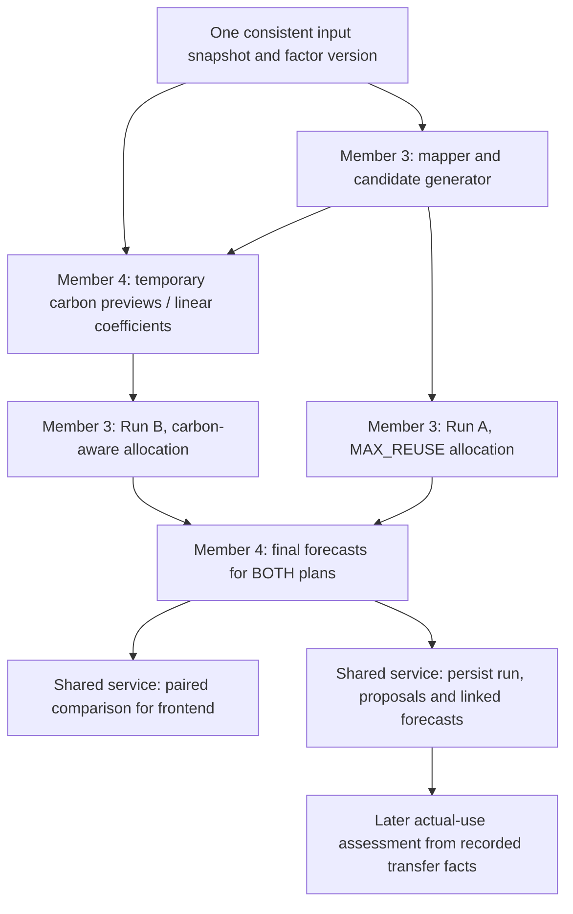

# Member 3 and Member 4 carbon cooperation

Prepared on 14 October 2026, Asia/Kuala_Lumpur. This is a proposed integration
guide for Shawn (Member 3), Weixuan (Member 4), and their coding agents. It explains
how one shared carbon calculation service can support optimisation and final
forecast assessments. The preview interfaces below are proposals to agree, not
implemented APIs or amendments to the database schema/SRS.

## The short explanation

Yes: Member 3 generates eligible candidates, asks Member 4's carbon service for
scores, uses those scores to choose allocations, and passes the final quantities
to the same carbon service for final forecast assessments.

These are internal Python calls in the shared FastAPI backend, not manual file
exchange between teammates or separate deployed services. Member 4 owns the
carbon formulas and factor selection. Member 3 owns operational eligibility and
the allocation objective/constraints. There is one carbon calculation owner.

For MAX_REUSE, carbon is not required to choose quantities. Member 3 can allocate
first and request forecasts afterward for display/comparison. The pre-allocation
scoring step is needed for MAX_NET_CO2E_AVOIDED.

Member 4 is responsible for the carbon assessments for both final plans, not
only the carbon-aware plan. Member 3 returns proposed allocations; Member 4
returns their carbon results and completeness/provenance. The shared service
assembles those outputs into a comparison response. Member 1 renders the UI;
the frontend does not implement a second carbon calculator.



## What currently exists

| Component or data | Observed state |
|---|---|
| Member 3 mapper | Validates existing collections, reconciles counters and derives incoming commitments |
| Member 3 eligibility | Evaluates one operational pair and its quantity cap |
| Member 3 candidate generator | Returns explained cross-project pairs; only ELIGIBLE pairs can be allocated |
| Member 3 MAX_REUSE allocator | Pure Python quantity optimisation; no carbon scoring dependency |
| AllocationPlan carbon fields | Carbon strategy returns a supplied-score-derived net estimate and missing/negative-score flags; not final impact assessments |
| Member 3 carbon-aware allocator | Implemented for Member 4's guaranteed linear coefficients; not connected to Member 4's service |
| Member 3 deadline allocator | Implemented: maximise pcs for each required_by group, earliest first |
| Carbon preview/scoring integration | Not implemented or connected to Member 4 |
| Seed emission_factors | Eight synthetic versioned factors, not verified Malaysian factors |
| Seed impact_assessments | Eight stored example outcomes, not a live scoring function for arbitrary candidates |
| Run/proposal/forecast persistence and HTTP integration | Not implemented in this Member 3 flow |

The current generator is [candidates.py](../backend/app/domain/candidates.py).
Use result.eligible; do not treat all result.pairs as allocatable.
Each EligibilityResult has supply_offer_id, demand_request_id,
max_allocatable_quantity, reason_codes, planning_date and delivery information.
Current seed generation produces 15 eligible pairs, one review-required pair and
372 ineligible pairs. Pair caps are independent limits, not a feasible joint plan.

The current allocator is [allocator.py](../backend/app/domain/allocator.py).
allocate_max_reuse(snapshot) remains supported. The new allocate(snapshot,
objective=...) selector supports all three dictionary objective names and
generates candidates internally. The carbon strategy consumes LinearCarbonScores;
the service connection and final assessments still need integration work.
See [allocator policies and examples](OPTIMISATION_ALLOCATOR.md).

## Responsibilities

| Work | Owner |
|---|---|
| Published reviewed supply/demand provenance | Member 2; consumed through shared records |
| Consistent database retrieval and shared snapshot | Shared repository/orchestration layer |
| Operational eligibility, stock/demand planning budgets, candidate generation | Member 3 |
| Factor applicability, versions, unit conversions and assessment boundaries | Member 4 |
| Carbon arithmetic, completeness flags and forecast/actual distinction | Member 4 |
| Final forecasts and carbon totals/completeness for BOTH alternative plans | Member 4 |
| Strategy selection and quantity allocation using agreed scores | Member 3 |
| Assemble plans and carbon assessments into a comparison response | Shared orchestration service; agree implementation owner |
| Render the comparison charts and values | Member 1, using returned assessments |
| Run/proposal IDs and persistence coordination | Shared optimisation service with Member 3; agree exact owner |
| Persisting linked impact assessments and their review/revision policy | Member 4 through shared repositories |
| Atomic reservation, dispatch, receipt, use and residual accounting | Member 4 |

Member 3 must not duplicate carbon formulas, manufacture missing factors, release
transfer promises or mutate stock counters. Member 4 must not reserve a candidate
merely because its carbon score is positive. Proposed allocation is not reuse.

## Two runs in one comparison operation

The intended comparison uses one frozen input snapshot, factor dataset and
assessment boundary, but creates two separate optimisation_runs records:

| Stage | Run A: MAX_REUSE | Run B: MAX_NET_CO2E_AVOIDED |
|---|---|---|
| Candidates | Shared operationally eligible pairs | The same pairs |
| Carbon before allocation | Not needed to select quantities | Member 4 supplies scores/model |
| Allocation | Member 3 maximises pcs | Member 3 optimises the agreed carbon objective |
| Final forecast | Member 4 assesses final Run A quantities | Member 4 assesses/verifies final Run B quantities |
| UI | Quantity, forecast carbon and incomplete flags | Quantity, forecast carbon and incomplete flags |

Each allocator starts from the original snapshot balances. Run A proposals must
not consume stock before calculating Run B. The plans are alternatives: neither
is automatically executed, and their quantities/emissions are not added together
as achieved reuse. The two strategies can return the same plan.

"Together" means coordinated execution for a fair comparison, not necessarily
parallel execution. MAX_REUSE can be calculated while carbon inputs are being
prepared, but no separate processes or background infrastructure are required.

Document 08's proposed POST /api/optimisation-runs currently accepts one objective.
The dictionary already permits multiple runs with the same input snapshot/hash,
but a single public comparison request/response needs an agreed API addition or
snapshot-bound orchestration of two single-objective requests. This guide does
not introduce a comparison endpoint or change the existing request contract.

## Step 1 Prepare shared inputs

Member 3 maps complete current records and generates candidates. Transfer state
already reduces both source stock and recipient need. Neither pending extraction
rows nor BOQ/PO quantities are offered directly to the optimiser.

The carbon service needs a frozen carbon context for the same run: full material
records, routes, emission_factors, planning date, factor_dataset_version and
calculation assumptions. Member 3's internal Material projection intentionally
does not retain mass_kg_per_unit; DomainSnapshot does not contain emission_factors.
Therefore Member 4 must receive those full shared records/context, not assume
that the existing mapped snapshot or candidate alone contains everything needed.

Do not fetch fresh factors independently midway through allocation. The shared
orchestrator should bind the run to one input snapshot/hash and factor version.
The existing inputs_snapshot_hash contract and material/route/factor provenance
must be preserved when the run service is implemented.

## Step 2 Obtain temporary pre-allocation scores

This step determines Run B's allocation. Run A does not require these scores to
maximise quantity, though both runs use the same frozen carbon context afterward.

Proposed internal function contracts, to agree with Member 4:

```python
# Names/signatures are illustrative, not existing functions or HTTP endpoints.
preview = carbon_service.assess_forecast_preview(request, carbon_context)

# Optional efficient interface, only if linear scaling is explicitly supported:
scores = carbon_service.score_linear_candidates(requests, carbon_context)
```

A temporary request identifies the pair and a hypothetical quantity; it does not
need a proposal_id. Proposed example payload (internal preview DTO only):

```json
{
  "supply_offer_id": "SUP-003",
  "demand_request_id": "DEM-003",
  "quantity": 200,
  "unit": "pcs",
  "planning_date": "2026-10-12",
  "factor_dataset_version": "demo-v1"
}
```

The same input snapshot reference/hash is supplied in carbon_context. This
example uses the baseline date, not the current date. The quantity is within
the current pair cap. It is a hypothetical substitution, not a dispatch claim.

Proposed preview result reuses assessment component names:

```json
{
  "supply_offer_id": "SUP-003",
  "demand_request_id": "DEM-003",
  "quantity_assessed": 200,
  "unit": "pcs",
  "avoided_production_kgco2e": 190,
  "additional_transport_kgco2e": 5.19168,
  "additional_processing_kgco2e": 4,
  "net_avoided_kgco2e": 180.80832,
  "calculation_status": "DEMO",
  "factor_ids": ["EF-002", "EF-007", "EF-008"],
  "baseline_description": "Hypothetical substitution of equivalent new pavers; synthetic demo boundary",
  "assumptions": {
    "synthetic": true,
    "moved_quantity": 200,
    "mass_kg_per_unit": 3.328,
    "distance_km": 65,
    "substitution_ratio": 1,
    "handling_allocation": "ALL_MOVED_UNITS",
    "omissions": ["baseline freight", "disposal", "credit issuance"]
  }
}
```

Numbers above are calculated from the existing synthetic factors and RTE-003;
they are not a claim of an existing persisted 200-piece assessment. This is not
a complete impact_assessments row: it has no stored assessment ID or proposal FK.

## Step 3 Optimise using the returned scores

This step describes Run B. Run A continues using its quantity objective without
carbon scores affecting its allocation decisions.

Member 3 retains operational constraints: source and recipient budgets, integer
pcs, material/spec/unit/condition/date eligibility, and no self-project reuse.
Carbon scoring does not turn REVIEW_REQUIRED or INELIGIBLE into ELIGIBLE.

For a linear demo, Member 4 can return a validated net kgCO2e/pcs coefficient,
plus component coefficients, factor IDs and assumptions. The contract must
explicitly guarantee that score(q) = q * coefficient throughout the allowed
quantity range. Member 3 uses this coefficient in the objective; this is applying
a supplied score, not reimplementing Member 4's factor arithmetic.

Do not derive a universal coefficient by dividing any arbitrary preview net by
its quantity. That is valid only under the explicitly supported linear model.
Fixed truck-trip costs, thresholds, shared vehicles or nonlinear processing costs
need a richer score function/optimisation formulation, not max-quantity previews
followed by a correction after allocation.

Incomplete assessments remain INSUFFICIENT_DATA with null required components/net.
They remain operationally eligible if their material/stock rules pass, but their
unknown carbon score must never become zero. The user agreed on 14 October 2026:
exclude unscored pairs from carbon allocation and flag incomplete scoring coverage;
exclude negative-benefit pairs; allow zero-benefit pairs under the quantity tie-break.
Maximise total net benefit, then total pcs, then individual pair preference:
deadline, delivery, distance and stable IDs. These policies are now implemented.

The internal LinearCarbonScores batch requires an allocation_snapshot_hash,
factor_dataset_version, carbon_context_id, net_kgco2e_per_piece mapping keyed by
(supply_offer_id, demand_request_id), and linear_scaling_guaranteed=True.
Coefficients must be finite Decimal values or None. Member 4 guarantees linearity
over each pair's full allowed quantity range. Orchestration supplies its expected
context ID and factor version independently; the allocator rejects mismatches,
stale mapped inputs and score IDs outside eligible candidates.

The mapped-input hash is distinct from the eventual persisted full input hash.
Member 4/shared orchestration still owns the immutable full carbon context and
factor provenance. An entirely unscored eligible set returns an empty plan with
carbon_scoring_available=False, incomplete_carbon=True and a None estimate.
Solver status remains SUCCEEDED because the calculation executed correctly;
orchestration/UI must surface the explicit unavailability rather than present a
zero-benefit optimum. The score-derived estimate is for selected quantities,
not a replacement for Member 4's linked final forecast records.

## Step 4 Assess the final quantities

Member 4 owns this step for BOTH Run A and Run B. A plan being MAX_REUSE does not
remove the need to calculate its forecast carbon when comparing strategies.

The allocator may choose less than a candidate cap. Suppose a preview was for
500 pcs but the final plan chooses 300 pcs. The final assessment must describe
300; it cannot copy the 500-piece totals unchanged.

Use the same Member 4 service and context to calculate/verify the final forecast.
If pair, quantity, snapshot, factors and assumptions are identical, the previous
result can be reused. If linear scaling is supported, Member 4 can calculate
final totals from its validated coefficients without another factor lookup.
Calculation reuse must be keyed by both quantity and complete calculation context.
Keeping a cache is optional; correctness must not depend on having one.

Member 4 does not need to recalculate simply because a value is shown in the UI.
An identical valid result can be reused; changed quantities/context require a
matching new calculation or the explicitly supported linear derivation. Member 1
displays the final results returned by the service. Carbon values are not merely
hidden internal allocator scores.

Member 4 should provide per-proposal components and plan-level carbon totals
with completeness information. Complete forecast assessments may be summed within
one plan under the same additive boundary. If any allocation lacks a required
net assessment, do not label the known subtotal as the complete plan's net benefit:
identify the incomplete allocations and clearly distinguish any known subtotal.
If costs are shared across allocations, such as one truck serving several pairs,
the carbon service must apply an agreed allocation rule to avoid double-counting
the trip. Never sum per-pair previews blindly in that model.

Only one authoritative final forecast is linked to each new proposal in the
initial implementation. Do not persist every temporary preview as an extra
achievement or aggregate previews and final forecasts together.

## Step 5 Persist linked records through the shared service

After final quantities and calculations are validated, the shared service assigns
stable run/proposal IDs and writes records through repositories/named operations:

```text
optimisation_runs.id
    -> allocation_proposals.run_id
        -> impact_assessments.proposal_id
```

Each strategy has its own run and uses the same comparison snapshot. Proposal
records retain PROPOSED status; no transfer/reservation is created automatically.
Actual persistence ordering/transaction and retry handling must be designed at
integration time; do not claim a safe persistence operation already exists.

For a stored forecast assessment, preserve the dictionary fields:

- basis = PROPOSAL_FORECAST.
- proposal_id = the actual newly assigned proposal ID, not a placeholder.
- transfer_id = null.
- quantity_assessed = final proposed_quantity, in the matching unit.
- Calculated component/net fields, factor_ids, baseline_description, assumptions,
  calculation_status and calculated_at.

The persistent schema requires the proposal link for this basis. Do not create
orphan preview records, add a CANDIDATE_PREVIEW enum, or alter that FK contract
just to accommodate temporary scoring. PRELIMINARY is an assessment status; it
does not remove the requirement for a proposal link.

The current seed contains one assessment per entity/basis. The approved SRS
requires reviewed immutable revisions later, but the existing schema does not
fully define revision identifiers/selection. Member 4 should agree that extension
before live recalculation, preserving history and preventing double counting.

## Step 6 Reassess actual outcomes later

Member 4's transfer workflow records dispatch, receipt and actual use. Production
substitution uses actual used quantity; transport uses actual moved quantity.
Unresolved missing/unused material affects commitments and assessment completeness.
Do not silently prorate freight to the smaller used quantity.

An actual assessment has basis = ACTUAL_CONFIRMED_USE, transfer_id populated and
proposal_id null, following the existing contract. Forecasts and actuals remain
separate. Avoided-emissions comparisons are not official GHG inventory deductions,
carbon credits or automatically verified waste diversion. No live Pantas link exists.

## Coding agent checklist and tests to agree

Read [Document 08](08_MODULE_INTERFACES.md),
[Document 09](09_ARCHITECTURE_UPDATE.md),
[the data dictionary](SEED_DATA_DICTIONARY.md) and the approved SRS before
implementing shared interfaces. This guide does not independently authorise
cloud provisioning, deployment or an application account model.

1. Agree temporary preview request/result types and immutable carbon context.
2. Agree factor-selection precedence, unit conversion, boundaries and synthetic flags.
3. Implement Member 4's agreed linear-scaling guarantee; trip costs need a later model.
4. Verify agreed missing/negative/zero-score policies and carbon secondary priorities.
5. Keep calculations directly testable without FastAPI/Firebase; use internal calls.
6. Add repository/HTTP mapping only through the shared architecture and contracts.
7. Test matching synthetic arithmetic, missing factors/mass/routes/handling,
   wrong factor units/materials and deterministic factor-version selection.
8. Test final quantities differing from previews, identical-input reuse and stale
   factor/snapshot rejection. Never reuse a result from a different context.
9. Test that carbon scoring does not mutate supply/demand, confirm suitability,
   reserve stock or turn forecasts into actual-use metrics.
10. Test final forecast-to-proposal FK/quantity alignment, repeat-safe persistence
    and separation of alternative runs, forecast/actual results and revisions.
11. Test Run A and Run B against the same original balances/context, and include
    final carbon assessments for both in the comparison output. Do not report an
    incomplete plan's known carbon subtotal as its complete net benefit.

The agreed architecture remains one React/FastAPI application with independent
Python services and repositories using Firebase SQL Connect. This guide creates
no new endpoints, schema fields, statuses or database operations.

## Simple summary for both members

**Member 3 decides where materials should go and how many pieces to propose.
Member 4 calculates the environmental outcome of those choices.**

```text
Run A — MAX_REUSE
Member 3: candidates -> maximise pieces -> allocation plan
Member 4: assess final quantities -> forecast carbon for Plan A

Run B — MAX_NET_CO2E_AVOIDED
Member 3: eligible candidates
Member 4: temporary carbon scores/model for those candidates
Member 3: use scores to choose quantities -> allocation plan
Member 4: assess/verify final quantities -> forecast carbon for Plan B

Shared service: Plan A + its assessments | Plan B + its assessments
Member 1: display the comparison
```

- Member 3 now selects MAX_REUSE, EARLIEST_DEADLINE or MAX_NET_CO2E_AVOIDED via an objective parameter.
- Quantity/deadline plans need no carbon input; the carbon plan needs Member 4's matching linear score batch.
- The carbon plan includes a score-derived net estimate and completeness flags; final forecasts remain Member 4's responsibility.
- Member 4 supplies carbon values for BOTH final plans through one calculation service.
- Reuse a preview only when the final quantity and calculation context match,
  or use Member 4's explicitly guaranteed linear model. Do not duplicate formulas.
- Temporary candidate scores are not saved as orphan impact_assessments.
- Final forecasts link to real proposals; actual-use assessments come later.
- Both runs start with the same data. Proposals do not reserve stock.
- The allocation strategies are implemented; Member 4 service, comparison and persistence integration are not connected yet.
